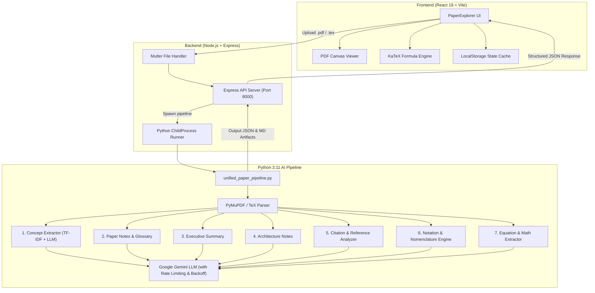

<div align="center">

# CogniWeave
### *Personalized Learning Intervention & Research Paper Intelligence System*

[](https://react.dev/)
[](https://nodejs.org/)
[](https://www.python.org/)
[](https://ai.google.dev/)
[](https://katex.org/)
[](https://www.docker.com/)

<p align="center">
  CogniWeave transforms dense, complex academic research papers (PDF & LaTeX) into an interactive, multi-dimensional learning workbench. It breaks down foundational concepts, mathematical notation, equations, system architectures, and literature citations into an interconnected, contextual knowledge graph.
</p>

---

</div>

## Table of Contents

- [Overview](#overview)
- [Key Features](#key-features)
- [System Architecture](#system-architecture)
- [Unified 7-Stage Extraction Pipeline](#unified-7-stage-extraction-pipeline)
- [Tech Stack](#tech-stack)
- [Project Directory Structure](#project-directory-structure)
- [Getting Started](#getting-started)
  - [Prerequisites](#prerequisites)
  - [1. Clone Repository](#1-clone-repository)
  - [2. Environment Configuration](#2-environment-configuration)
  - [3. Python Environment Setup](#3-python-environment-setup)
  - [4. Node Backend Setup](#4-node-backend-setup)
  - [5. React Frontend Setup](#5-react-frontend-setup)
- [Running the Application](#running-the-application)
  - [Development Mode](#development-mode)
  - [Production Mode](#production-mode)
  - [Docker Deployment](#docker-deployment)
- [API Reference](#api-reference)
- [Keyboard Shortcuts & UI Navigation](#keyboard-shortcuts--ui-navigation)
- [Configuration Reference](#configuration-reference)
- [Roadmap](#roadmap)
- [License](#license)

---

## Overview

Reading modern scientific and machine learning research papers can be overwhelming due to dense mathematical nomenclature, intricate system architectures, and deep citation dependencies. 

**CogniWeave** bridges this gap by functioning as an intelligent AI-guided research companion:
- **Digests Both PDF and LaTeX Sources**: Ingests standard scientific PDFs or raw `.tex` source files.
- **Deconstructs Paper Complexity**: Automatically extracts, classifies, and cross-references key concepts, math symbols, formulas, and references.
- **Synchronized Three-Pane Workbench**: View the original paper alongside structured breakdowns with bi-directional navigation (click any concept or equation to highlight its exact page occurrences).

---

## Key Features

### 1. Dual-Format Ingestion (PDF & LaTeX)
Upload pre-compiled scientific papers (`.pdf`) or author source packages (`.tex`). The backend normalizes whitespace, strips compilation artifacts, extracts structured sections, and feeds clean text into downstream extractors.

### 2. 7-Stage Autonomous AI Extraction Pipeline
Orchestrated via a single unified workflow:
- **Key Concept Extraction**: Hybrid N-Gram TF-IDF candidate selection + Gemini LLM semantic refinement.
- **Context-Rich Glossary**: Synthesizes definitions, cross-concept relationship tags, and section citations.
- **Executive Summaries**: Synthesizes TL;DR, core research questions, major contributions, and section timelines.
- **System & Model Architecture**: Generates structured technical breakdowns with Markdown tables and algorithmic flowcharts.
- **Citation & Literature Graph**: Classifies cited works by influence role (*Foundational, Baseline, Comparison, Theoretical Support*).
- **Mathematical Nomenclature**: Compiles a dedicated notation dictionary mapping every Greek symbol/variable to its paper definition.
- **LaTeX Formula Solver**: Extracts equations into clean LaTeX markup and links variables directly to the notation glossary.

### 3. Interactive 3-Pane Research Workbench
- **Left Pane (Document Viewer)**: PDF renderer with page-by-page scrolling, jump-to-page anchors, and responsive scaling.
- **Center Pane (Master Explorer)**: Filter by node type (*All, Concepts, Notations, Equations, References*), live search, and auto-filter to current page view.
- **Right Pane (Detail & Knowledge Inspector)**: Deep-dive inspector with KaTeX math rendering, influence badges, inter-concept links, and clickable page occurrences.
- **Executive Summary & Architecture Views**: One-click toggle between granular entity cards, full-paper executive summaries, and system design specifications.

### 4. VS Code-Inspired Productivity Controls
- **Adjustable Split Panes**: Smooth draggable borders between PDF viewer, entity list, and detail inspector.
- **Hotkey Support**: Toggle panes instantly using `Alt + 1` (PDF), `Alt + 2` (Master list), and `Alt + 3` (Detail pane).
- **Persistent State**: Seamless `localStorage` caching ensures you never lose extracted paper sessions across refreshes.

---

## System Architecture



---

## Unified 7-Stage Extraction Pipeline

The Python pipeline is located in `pipeline/research_paper/` and coordinated by `unified_paper_pipeline.py`:

| Stage | Script | Purpose / Output |
| :--- | :--- | :--- |
| **1. Concepts** | [`extract_paper_concepts.py`](pipeline/research_paper/extract_paper_concepts.py) | Generates `concepts.json` using smoothed TF-IDF scoring and LLM candidate filtering. |
| **2. Notes & Glossary** | [`generate_paper_notes.py`](pipeline/research_paper/generate_paper_notes.py) | Generates `notes.md` with definitions, cross-concept linkages, and section citations. |
| **3. Summary** | [`generate_paper_summary.py`](pipeline/research_paper/generate_paper_summary.py) | Generates `summary.json` with TL;DR, research questions, contributions, and timeline. |
| **4. Architecture** | [`generate_architecture_notes.py`](pipeline/research_paper/generate_architecture_notes.py) | Generates `architecture_notes.md` detailing system modules, pipeline specs, and dataflow tables. |
| **5. References** | [`extract_paper_references.py`](pipeline/research_paper/extract_paper_references.py) | Generates `references.json` with citation keys, titles, roles, and contextual sentences. |
| **6. Notations** | [`extract_notations_local.py`](pipeline/research_paper/extract_notations_local.py) | Generates `notations.json` containing mathematical symbols, Greek letters, and meanings. |
| **7. Equations** | [`extract_paper_equations.py`](pipeline/research_paper/extract_paper_equations.py) | Generates `equations.json` with LaTeX markup, raw OCR/scanned text, and math descriptions. |

---

## Tech Stack

### Frontend
- **Framework**: React 18 + Vite
- **Math Typesetting**: KaTeX (CDN with fast LaTeX formula parsing)
- **Styling**: Vanilla CSS3 (Custom design system, glassmorphism, responsive CSS grid/flexbox, Dark/Light theme context)
- **State**: React Hooks + LocalStorage session persistence

### Backend
- **Runtime**: Node.js (ES Modules, Express 4.x)
- **File Ingestion**: Multer (disk storage with session UUID partitioning)
- **Pipeline Bridge**: Asynchronous Node.js `child_process.spawn`
- **Security & Utilities**: CORS, dotenv, Zod, UUID

### AI & Data Pipeline
- **Python**: 3.11+
- **PDF & Document Parsing**: PyMuPDF (`fitz`), `pdfplumber`, regex-based LaTeX AST parsing
- **LLM Engine**: Google Generative AI (`google-generativeai`), Gemini 2.5 / 3.1 Flash Lite
- **Resilience**: Thread-safe rate limiter (15 RPM compliant), exponential backoff with jitter for HTTP 429/503

---

## Project Directory Structure

```text
CogniWeave-Personalized-Learning-Intervention-System/
├── backend-node/                 # Express.js Backend
│   ├── src/
│   │   ├── routes/
│   │   │   ├── health.js         # Health check endpoint (/health)
│   │   │   └── paper.js          # Paper upload, pipeline execution & PDF streaming
│   │   ├── uploads/papers/       # Session storage for uploaded papers & extracted JSON
│   │   ├── config.js             # Environment and path settings
│   │   └── server.js             # Application entry point & static asset serving
│   ├── package.json
│   └── nodemon.json
├── frontend-react/               # React 18 + Vite Frontend
│   ├── src/
│   │   ├── components/
│   │   │   ├── PaperExplorer/
│   │   │   │   ├── PaperExplorer.jsx   # 3-Pane master workbench & KaTeX renderer
│   │   │   │   ├── PdfViewer.jsx       # Integrated PDF viewer with page navigation
│   │   │   │   └── UploadZone.jsx      # Drag & drop upload target (.pdf & .tex)
│   │   │   ├── Banner.jsx              # Status alert component
│   │   │   ├── Card.jsx                # UI container card
│   │   │   └── ThemeToggle.jsx         # Dark / Light theme switcher
│   │   ├── context/
│   │   │   └── ThemeContext.jsx        # Theme persistence provider
│   │   ├── App.jsx                     # Top-level portal layout & connection badge
│   │   ├── App.css                     # Primary workspace styles
│   │   ├── index.css                   # Core tokens, themes & layout CSS
│   │   └── main.jsx                    # React DOM root
│   ├── package.json
│   └── vite.config.js
├── pipeline/                     # Python AI & Document Extraction Pipeline
│   ├── research_paper/
│   │   ├── extract_paper_concepts.py      # TF-IDF + Gemini concept extraction
│   │   ├── generate_paper_notes.py        # Glossary & connection compiler
│   │   ├── generate_paper_summary.py      # TL;DR & section breakdown
│   │   ├── generate_architecture_notes.py # System architecture & Markdown tables
│   │   ├── extract_paper_references.py    # Citation role classifier
│   │   ├── extract_notations_local.py     # Math notation dictionary builder
│   │   ├── extract_paper_equations.py     # LaTeX equation extractor
│   │   ├── pdf_utils.py                   # PyMuPDF TOC and section segmenter
│   │   ├── tex_utils.py                   # LaTeX section & equation parser
│   │   └── unified_paper_pipeline.py      # Master runner for all 7 stages
│   ├── extraction_parameters.md           # Parameter documentation for scoring
│   └── utils.py                           # Gemini retry client, JSON repair & rate limiter
├── Dockerfile                    # Dual Python 3.11 + Node 20 container definition
├── requirements.txt              # Python dependencies
└── .env                          # Environment variables & API keys
```

---

## Getting Started

### Prerequisites
Make sure you have the following installed on your machine:
- [Node.js](https://nodejs.org/) (v18.x or v20.x recommended)
- [Python](https://www.python.org/) (v3.10, v3.11, or v3.12)
- [Git](https://git-scm.com/)
- A [Google Gemini API Key](https://aistudio.google.com/app/apikey)

---

### 1. Clone Repository
```bash
git clone https://github.com/likhit2804/CogniWeave-Personalized-Learning-Intervention-System.git
cd CogniWeave-Personalized-Learning-Intervention-System
```

---

### 2. Environment Configuration
Create a `.env` file in the project root (or update the existing one):

```env
# Gemini API Key for Extraction Pipeline
GEMINI_API_KEY=your_gemini_api_key_here

# LLM Model Selection
LLM_MODEL=gemini-3.1-flash-lite
AGENT_MODEL=gemini-3.1-flash-lite
LLM_FALLBACK_MODELS=gemini-3.1-flash-lite,gemini-2.5-flash-lite

# Server Configuration
PORT=8000

# Path to Python executable (Relative to project root)
# Windows:
PYTHON_PATH=.\venv\Scripts\python.exe
# Linux / macOS:
# PYTHON_PATH=./venv/bin/python
```

---

### 3. Python Environment Setup
Set up a Python virtual environment and install dependencies:

```bash
# Create virtual environment
python -m venv venv

# Activate virtual environment
# Windows:
.\venv\Scripts\activate
# macOS / Linux:
source venv/bin/activate

# Install requirements
pip install -r requirements.txt
```

---

### 4. Node Backend Setup
Install backend dependencies:

```bash
cd backend-node
npm install
cd ..
```

---

### 5. React Frontend Setup
Install frontend dependencies:

```bash
cd frontend-react
npm install
cd ..
```

---

## Running the Application

### Development Mode

Run the backend and frontend in separate terminal windows for live reloading:

#### Terminal 1 — Start Backend:
```bash
cd backend-node
npm run dev
```
*Backend runs on `http://localhost:8000`*

#### Terminal 2 — Start Frontend:
```bash
cd frontend-react
npm run dev
```
*Frontend dev server runs on `http://localhost:5173` (proxies requests to port 8000)*

---

### Production Mode

Build the frontend static assets and let Express serve everything:

```bash
# 1. Build React app
cd frontend-react
npm run build
cd ..

# 2. Start Node server
cd backend-node
npm start
```
*Open your browser and visit: `http://localhost:8000`*

---

### Docker Deployment

You can build and deploy the entire multi-runtime application using Docker:

```bash
# Build Docker image
docker build -t cogniweave:latest .

# Run container with environment variables
docker run -p 8000:8000 --env-file .env cogniweave:latest
```
*Visit `http://localhost:8000` in your browser.*

---

## API Reference

### 1. Upload and Analyze Research Paper
- **Endpoint**: `POST /paper/analyze`
- **Content-Type**: `multipart/form-data`
- **Body**: `file` (File buffer, `.pdf` or `.tex`)
- **Response**:
```json
{
  "sessionId": "26bc2418-4a11-4327-836a-2748f6684683",
  "paperTitle": "Deep Residual Learning for Image Recognition",
  "fileType": "pdf",
  "pdfUrl": "/paper/pdf/26bc2418-4a11-4327-836a-2748f6684683",
  "summary": {
    "executive": "...",
    "tldr": "...",
    "research_question": "...",
    "contributions": ["..."],
    "sections": [{ "title": "Introduction", "summary": "..." }]
  },
  "architectureNotes": "# System Architecture\n...",
  "nodes": [
    {
      "id": "residual_mapping",
      "label": "Residual Mapping",
      "definition": "A formulation where layers fit a residual mapping...",
      "type": "concept",
      "sources": [{ "page": 2, "section": "3. Deep Residual Learning" }]
    },
    {
      "id": "equation_0",
      "label": "Equation 1",
      "definition": "Residual block formulation",
      "latex": "y = \\mathcal{F}(x, \\{W_i\\}) + x",
      "type": "equation",
      "sources": [{ "page": 3, "section": "3.1 Formulation" }]
    }
  ]
}
```

### 2. Stream Original Document
- **Endpoint**: `GET /paper/pdf/:sessionId`
- **Response**: `application/pdf` or `text/plain` stream.

### 3. Clear Paper Session
- **Endpoint**: `DELETE /paper/:sessionId`
- **Response**: `{ "detail": "Session files deleted successfully." }`

### 4. Health Check
- **Endpoint**: `GET /health`
- **Response**: `{ "status": "ok" }`

---

## Keyboard Shortcuts & UI Navigation

| Shortcut | Action |
| :--- | :--- |
| <kbd>Alt</kbd> + <kbd>1</kbd> | Toggle Document / PDF Viewer Pane |
| <kbd>Alt</kbd> + <kbd>2</kbd> | Toggle Master Entities List Pane |
| <kbd>Alt</kbd> + <kbd>3</kbd> | Toggle Entity Detail & Inspector Pane |
| **Draggable Splitters** | Click and drag vertical borders to customize pane widths |
| **Page Occurrence Links** | Click any `Page X` occurrence to instantly scroll the PDF to that page |
| **Equation Symbols** | Click any highlighted math variable in an equation to jump directly to its notation definition |

---

## Configuration Reference

| Variable | Type | Default | Description |
| :--- | :--- | :--- | :--- |
| `GEMINI_API_KEY` | String | *Required* | Google AI Studio API key for Gemini models. |
| `LLM_MODEL` | String | `gemini-3.1-flash-lite` | Primary LLM model for concept and math extraction. |
| `AGENT_MODEL` | String | `gemini-3.1-flash-lite` | Secondary/Agent LLM model identifier. |
| `LLM_FALLBACK_MODELS` | CSV | `gemini-3.1-flash-lite,gemini-2.5-flash-lite` | Comma-separated list of fallback models on quota/timeout. |
| `PORT` | Number | `8000` | Port for the Express backend server. |
| `PYTHON_PATH` | String | `python` | Path to the Python executable with pipeline dependencies. |
| `NEO4J_URI` | URI | *Optional* | Neo4j Aura connection URI for graph database persistence. |
| `MONGO_URI` | URI | *Optional* | MongoDB connection URI for persistent user learning sessions. |

---

## Roadmap

- [x] Full PDF & LaTeX source ingestion
- [x] 7-Stage autonomous extraction pipeline (Concepts, Summary, Architecture, Citations, Notations, Equations)
- [x] KaTeX mathematical formula rendering & notation linking
- [x] Multi-pane responsive research workbench with hotkeys
- [ ] Interactive 2D/3D Knowledge Graph Visualization (Force-directed graph canvas)
- [ ] Multi-Paper Comparative Explorer (diffing methodologies and benchmark results)
- [ ] Audio Synthesis / AI Podcast generation for paper summaries
- [ ] Export to Anki flashcards & Notion workspace pages

---

## License

This project is licensed under the [MIT License](LICENSE).

---

<div align="center">
  <sub>Built for researchers, engineers, and lifelong learners.</sub>
</div>
