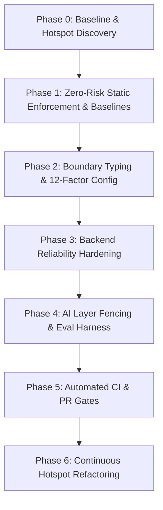

# Project Adoption Plan & Ongoing Commit Workflow

> **Status:** Strategy & Operational Guide  
> **Target Audience:** Backend Engineers, AI/ML Engineers, Full-Stack Developers, Tech Leads, and Autonomous AI Agents  
> **Scope:** How to systematically apply the Code Quality Guide to an **existing (brownfield) project** without disrupting ongoing delivery, and exactly how developers and AI agents must work from **future commits onward**.  
> 🤖 **Mandatory Protocol for AI Agents:** When applying this plan to a codebase, you must execute **strictly ONE phase/guideline at a time**, verify changes, and **PAUSE for human confirmation** before proceeding. See **[AGENTS.md](file:///c:/Users/likhi/OneDrive/Pictures/Desktop/CollabProj/PaperMind/code_quality_guide/AGENTS.md)**.

---

## 1. Executive Summary & Core Philosophy

Adopting code quality and maintainability standards on an **already created, active project** is fundamentally different from starting a greenfield project. If a team halts feature delivery for a month to "clean up everything," the effort almost always fails: business stakeholders get frustrated, big-bang refactors introduce regressions, and old habits quickly return.

### The Three Golden Rules of Brownfield Adoption

1. **Ratchet, Do Not Big-Bang:**  
   Never attempt to fix all existing violations at once. Instead, record today's violations as a baseline. The CI pipeline fails **only on new violations or modified lines**. Quality only moves in one direction: upward.
2. **Make the Right Thing the Easy Thing:**  
   Engineers will not follow a 50-page guide out of memory. Tooling, pre-commit hooks, linters, templates, and automated CI checks must enforce standards automatically so that human code reviews can focus entirely on design, logic, and architecture.
3. **The Boy Scout Rule (Fix on Touch):**  
   Whenever an engineer touches an existing file to implement a feature or fix a bug, they are expected to leave that file cleaner than they found it (e.g., add type hints, extract a nested loop, add a missing test, add timeouts to outbound calls).

---

## 2. Phased Adoption Roadmap for Existing Projects

This phased rollout is designed to deliver immediate reliability wins in week 1 without blocking normal product velocity.



---

### Phase 0: Baseline Audit & Hotspot Discovery (Days 1–3)
*Goal: Understand where the actual pain and fragility live before touching any code.*

1. **Identify High-Risk Hotspots:**  
   Combine Git churn (frequency of edits) with code complexity. Files that change frequently *and* have high complexity account for the vast majority of production bugs.
   ```bash
   # Find top 20 most frequently changed files in the last 6 months:
   git log --since='6 months ago' --name-only --pretty=format: | sort | uniq -c | sort -rn | head -20
   ```
2. **Audit Outbound Calls (The "Silent Killers"):**  
   Search the codebase for network calls (HTTP requests, database connections, Redis queries, third-party LLM API calls) that lack explicit timeouts.
3. **Audit Unhandled Rejections / Exceptions:**  
   Identify bare `except:` or `try...catch` blocks that swallow exceptions (`pass` or empty catch blocks).
4. **Establish the Technical Debt Register:**  
   Create `docs/tech_debt_register.md` or tag issues with `label:tech-debt`. Record known hacks, unvalidated boundaries, and missing tests.

---

### Phase 1: Zero-Risk Static Enforcement (Week 1)
*Goal: Stop the bleeding. Ensure no new formatting debates or basic lint errors enter the repository.*

1. **Introduce a Formatter via a Single Dedicated Commit:**
   - For Python: `ruff format`
   - For Node / TypeScript: `prettier --write`
   - **Crucial Git Blame Protection:** Run the formatter across the entire repository in **one isolated commit** (e.g., `style: format entire repository with ruff/prettier`).
   - Add that commit's SHA to `.git-blame-ignore-revs` so that `git blame` does not attribute existing logic to the formatting commit.
2. **Configure Linters with a Baseline:**
   - Configure Ruff (`pyproject.toml`) and ESLint (`eslint.config.js`).
   - Do not force the team to fix 2,000 legacy warnings immediately. Generate a baseline file or configure the tool to fail **only on files touched in pull requests**.
3. **Create the Local Task Runner:**
   - Standardize developer commands via a `Makefile` or `npm run` scripts so that running `make check` locally runs the exact same checks as CI.

---

### Phase 2: Boundary Typing & 12-Factor Configuration (Weeks 2–3)
*Goal: Prevent runtime crashes caused by unexpected `None`/`undefined` and unvalidated environment variables.*

1. **Validate Environment Settings at Startup:**
   - Convert loose `process.env` or `os.getenv` lookups into typed configuration classes (e.g., using `pydantic-settings` in Python or a schema validator like `zod`/`joi` in Node).
   - If a required variable (`GEMINI_API_KEY`, `DATABASE_URL`) is missing or invalid, crash immediately at boot with a descriptive error message rather than failing mid-request.
   - Wrap secrets in `SecretStr` so they cannot be accidentally logged or printed.
2. **Type Checking at System Boundaries:**
   - Define strict input/output schemas for all incoming HTTP requests and background job payloads.
   - Enforce type annotations on all new functions and public service methods. Use type-checker overrides to temporarily allow legacy modules without types until touched.

---

### Phase 3: Backend Reliability Hardening (Month 1)
*Goal: Immunize the existing service against downstream network failures and cascading outages.*

1. **Mandate Timeouts on Every Outbound Call:**
   - Set connection timeouts (1–2 seconds) and read timeouts (sized to the workload) on all HTTP clients (Axios, Fetch, Requests, HTTPX).
   - Set statement timeouts on database query connections.
2. **Standardize Retries with Exponential Backoff + Jitter:**
   - Audit retry loops. Only retry **transient** errors (429, 502, 503, connection drop, timeout). Never retry client validation errors (400, 422).
   - Add random jitter to retry delays to avoid the "thundering herd" problem against struggling upstream services.
3. **Idempotency on State-Changing Endpoints:**
   - Accept an `Idempotency-Key` on payment, order creation, or asynchronous paper extraction triggers.
   - Enforce idempotency using database unique constraints rather than check-then-insert code.

---

### Phase 4: AI Layer Fencing & Evaluation Harness (Month 1 – Month 2)
*Goal: Turn non-deterministic LLM behavior into a predictable, tested, and observable pipeline.*

1. **Extract Model Calls Behind a Unified Client Protocol:**
   - Wrap raw SDK calls (`google.generativeai`, `openai`, etc.) inside a dedicated `LLMClient` class.
   - Consolidate token counting, latency logging, cost calculation, timeouts, and retries into this single client.
2. **Treat Prompts as Code:**
   - Move inline multiline prompt strings out of Python/Node code and into versioned prompt files (e.g., `prompts/extraction/v1.jinja` or `.md`).
   - Implement strict template rendering (throw an error if a variable is missing).
3. **Validate All Structured Model Outputs:**
   - Enforce strict JSON schema validation (Pydantic / Zod) on model responses.
   - Implement a **bounded repair loop** (maximum 1 retry) that shows the model its validation error if the output is malformed. If it still fails, fall back to a safe default or explicit domain error.
4. **Create a Starter Golden Eval Dataset:**
   - Assemble 20–50 representative, anonymized input papers/queries with verified expected outputs.
   - Include adversarial edge cases (malformed LaTeX, truncated PDFs, prompt injection attempts).
   - Run a smoke eval on this dataset whenever prompts or model versions are modified.

---

### Phase 5: Automated CI & Pull Request Gates (Month 2)
*Goal: Automate all verification so regressions cannot be merged to `main`.*

1. **Pre-Commit Hooks:**
   - Install `.pre-commit-config.yaml` to run fast checks locally: formatting, fast lint, secret scanning (Gitleaks). Must complete in under 5 seconds.
2. **Fast, Parallel GitHub Actions Pipeline:**
   - Job 1: Static checks (lint + typecheck).
   - Job 2: Fast unit tests (with fake LLM and mocked network).
   - Job 3: Integration tests (against local containerized DB).
   - Job 4: Security audit (`pip-audit`, `npm audit`, secret scanning).
3. **Branch Protection:**
   - Require CI to pass and at least one peer approval before merging to `main`.
   - Enforce **diff coverage** (e.g., 80% coverage on newly written/modified lines) rather than an impossible global coverage requirement.

---

### Phase 6: Continuous Hotspot Refactoring & Debt Paydown (Ongoing)
*Goal: Steadily improve code quality as part of everyday development.*

1. **Reserve 10–20% of Sprint Capacity for Technical Debt:**
   - Never run a standalone "refactoring sprint." Instead, address technical debt in the same modules touched by feature stories.
2. **Characterization Tests Before Refactoring:**
   - Before rewriting legacy code, write a characterization test recording current inputs and outputs. Refactor safely under the protection of that test.
3. **The Strangler Fig Pattern:**
   - When a legacy component (e.g., an monolithic extractor) is too complex to repair in-place, put an interface/facade in front of it, route new requests to a clean sub-component, and incrementally migrate behavior until the old component can be deleted.

---

## 3. Application to PaperMind Specifically

PaperMind is an active multi-tier application containing:
- **`pipeline/` (Python 3.11+)**: Research paper parsing, LaTeX/notation extraction, concept classification, Gemini LLM prompting.
- **`backend-node/` (Node.js Express)**: API gateway, RAG orchestrator, continuous Soft RRF engine, document management.
- **`frontend-react/` (React 18 + Vite)**: 3-pane workbench, KaTeX math viewer, HexiBot interactive assistant.

Here is the tailored execution plan for each layer:

| Component | Immediate Quality Target | Specific Action Items |
| :--- | :--- | :--- |
| **Python Pipeline (`pipeline/`)** | Deterministic AI Pipeline & Type Safety | • Configure `ruff` and `mypy` in `pyproject.toml`.<br>• Extract inline Gemini prompts from `extract_paper_concepts.py` and `extract_paper_equations.py` into dedicated `prompts/` templates.<br>• Introduce a `FakeGeminiClient` so the 7 extraction pipeline stages can be tested in CI without live API keys.<br>• Add Pydantic schemas for concept and equation outputs with bounded 1-retry repair loops. |
| **Node Backend (`backend-node/`)** | Reliability, Timeouts & Error Boundaries | • Add explicit timeouts (e.g., 30s) to all downstream child process executions and Gemini RAG queries.<br>• Standardize error responses to RFC 9457 Problem Details format.<br>• Replace loose `console.log` with structured JSON logging containing `request_id`.<br>• Implement connection timeouts and health/readiness endpoints (`/health/live`, `/health/ready`). |
| **React Frontend (`frontend-react/`)** | Component Boundaries & State Resilience | • Enable strict linting with `eslint-plugin-react-hooks`.<br>• Add React Error Boundaries around KaTeX math rendering blocks so an unparseable equation does not crash the entire workbench.<br>• Sanitize Markdown and LaTeX inputs to eliminate XSS risks in user-supplied documents. |

---

## 4. "From Later Commits What to Do" — The Daily Developer Workflow

Every developer contributing to the repository after this guide is introduced must follow this standard commit lifecycle:

```
[Issue / Ticket] 
       │
       ▼
1. Branch & Check Hotspots ──► Is file complex/frequent? Write characterization test first.
       │
       ▼
2. Write Code & Tests ───────► Boy Scout rule: type touched methods, add guard clauses, no bare catches.
       │
       ▼
3. Pre-Commit Validation ────► Run `make check` (format, lint, types, fast tests).
       │
       ▼
4. Craft Conventional Commit ─► `feat(pipeline): ...`, `fix(backend): ...`
       │
       ▼
5. Pull Request Submission ──► Complete PR template, attach test/eval evidence, diff coverage >80%.
       │
       ▼
6. Peer Review & Merge ──────► Review order: Design → Correctness → Tests → Readability → Nits.
```

---

### Step 1: Pre-Coding Checklist (Before Editing Files)
- [ ] Check if the file you are modifying is a known **hotspot** (high churn + complexity).
- [ ] If modifying a legacy function without test coverage, write a **characterization test** *before* changing anything.
- [ ] Pull latest `main` to avoid drift.

---

### Step 2: During Coding (The "Boy Scout" Commit Rule)
Every commit that modifies existing files must adhere to:
- **Guard Clauses:** Flatten nested `if` statements. Early exits for preconditions.
- **Specific Exceptions:** Never use bare `except:` or `catch (e) {}`. Catch the exact failure (`FileNotFoundError`, `TimeoutError`), log context (without secrets), and handle or re-raise.
- **No Unbounded Network Calls:** If adding an HTTP request or database query, you *must* pass a timeout.
- **Boundary Validation:** If receiving external input (HTTP body, query param, LLM output), parse through a schema before passing to inner services.
- **Leave It Cleaner:** Add missing type hints to any function signature you edit. Remove any dead code or outdated comments you encounter in that function.

---

### Step 3: Pre-Commit Verification (Local Laptop Gate)
Before running `git commit`, run the project check command:
```bash
# In Python pipeline:
ruff check --fix .
ruff format .
mypy pipeline/

# In Node backend / React frontend:
npm run lint
npm run test
```
*Never bypass pre-commit hooks with `--no-verify` unless in an authorized, logged emergency.*

---

### Step 4: Crafting the Commit Message (Conventional Commits)
All commit messages must follow the **Conventional Commits** specification:

```
<type>(<scope>): <short imperative description>

[optional body explaining WHY this change was made and what alternatives were rejected]

[optional footer: ticket reference, breaking changes]
```

#### Allowed Types:
- `feat`: A new user-facing feature or extraction capability.
- `fix`: A bug fix (should ideally be accompanied by a regression test).
- `refactor`: Code restructuring without changing observable behavior.
- `test`: Adding or updating tests (unit, integration, characterization).
- `docs`: Documentation, README, ADRs, or docstrings only.
- `perf`: A code change that improves performance or latency.
- `chore`: Tooling, dependency updates, configuration changes.

#### Good vs. Bad Commit Examples:
- ❌ **Bad:** `git commit -m "fixed bug in concepts"` (Vague, no explanation of why or which bug).
- ❌ **Bad:** `git commit -m "wip"` or `git commit -m "updates"` (Destroys Git bisect and history).
- ✅ **Good:**
  ```text
  fix(pipeline): prevent division by zero in empty LaTeX equation parser

  When an uploaded paper contains an empty display math block ($$),
  the notation tokenizer raised an unhandled ZeroDivisionError.
  Added a guard clause to return an empty notation set early.

  Closes #142
  ```

---

### Step 5: Pull Request Discipline
1. **Keep PRs Small (< 300 lines changed):**  
   Large PRs take days to review, get superficial reviews, and hide bugs. Break features into stacked PRs or feature-flagged increments.
2. **Separate Refactoring from Feature PRs:**  
   Never mix a 500-line rename/restructure with a 10-line bug fix. Ship the refactor in PR #1, then the fix in PR #2.
3. **Fill Out the PR Template:**  
   Every PR must explain **What and Why**, **How it was tested**, and **Risks / Rollout implications**.

---

### Step 6: Special Rules for AI & Prompt Commits
Whenever a commit modifies a prompt, model parameter, or LLM pipeline step:
1. **Prompt Versioning Rule:**  
   Never modify a prompt in-place without bumping its version identifier (e.g., `v2` → `v3`).
2. **Changelog Entry:**  
   Add a line to `prompts/CHANGELOG.md` explaining *why* the prompt was changed (e.g., *"Added negative examples to reduce hallucination on math symbol definitions"*).
3. **Smoke Eval Required:**  
   Run the test eval suite and paste the before/after score in the PR description. A prompt change without eval results is treated as untested code.

---

### Step 7: Hotfix & Emergency Protocol
In the event of a critical production outage:
1. An emergency fix branch `hotfix/<issue>` may be created directly from `main`.
2. Even in an emergency, the fix must include:
   - A minimal regression test reproducing the failure.
   - Passing automated CI tests.
3. If pre-commit hooks or strict checks are temporarily relaxed due to emergency circumstances:
   - Create a follow-up ticket with `label:tech-debt` immediately to restore full compliance within 48 hours.

---

## 5. Summary Checklist for Every Future Commit

```markdown
- [ ] Did I verify my changes locally using the project test/lint command?
- [ ] Are all new or modified functions properly typed and documented?
- [ ] Did I add timeouts to all new network or external operations?
- [ ] Is input validated at the boundary before processing?
- [ ] If fixing a bug, did I include a regression test that fails without the fix?
- [ ] If changing a prompt or AI feature, did I bump the prompt version and run evals?
- [ ] Does my commit message follow Conventional Commits (`feat:`, `fix:`, etc.)?
- [ ] Did I leave the files I touched a little cleaner than I found them?
```
