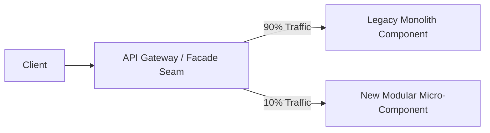

# 07. Refactoring & Technical Debt

> **Module:** Codebase Evolution & Architecture Health  
> **Source:** Section 8 of the Revised Code Quality Guide  
> **Related:** [00. Project Adoption Plan](file:///c:/Users/likhi/OneDrive/Pictures/Desktop/CollabProj/PaperMind/code_quality_guide/00_project_adoption_plan_and_commit_workflow.md) | [01. Clean Code](file:///c:/Users/likhi/OneDrive/Pictures/Desktop/CollabProj/PaperMind/code_quality_guide/01_clean_code_fundamentals.md) | [04. Testing Strategy](file:///c:/Users/likhi/OneDrive/Pictures/Desktop/CollabProj/PaperMind/code_quality_guide/04_testing_strategy.md)

---

## 1. The Rules of Safe Refactoring

Refactoring is defined as **changing the internal structure of code without altering its external, observable behavior**.

### The Cardinal Rules
1. **Never Refactor Without Automated Tests:** If you modify code without an automated test safety net, you are not refactoring; you are gambling. If tests are absent, write **characterization tests** first (see [04. Testing Strategy](file:///c:/Users/likhi/OneDrive/Pictures/Desktop/CollabProj/PaperMind/code_quality_guide/04_testing_strategy.md)).
2. **Take Micro-Steps:** Make one small transformation, run the tests, and verify they pass. Never perform twenty edits simultaneously.
3. **Commit Separately:** Commit structural refactors in a dedicated commit or separate PR before introducing new functional features.
4. **Preparatory Refactoring ("Make the Change Easy"):**  
   > *"For each desired change, make the change easy (warning: this may be hard), then make the easy change."* — Kent Beck.  
   If a new feature feels difficult to wedge into an existing class, first refactor the class so that adding the feature becomes trivial.
5. **The Boy Scout Rule:** Leave every file a little cleaner than you found it. Keep cleanups proportional to the task at hand; a drive-by rewrite of unrelated modules is not a cleanup.

---

## 2. Refactoring Catalog & Quick Reference

| If You Encounter | Recommended Refactoring |
| :--- | :--- |
| Long function with multiple responsibilities | **Extract Function:** Break into small, single-purpose functions. |
| Cryptic or abbreviation-heavy names | **Rename Symbol:** Use domain-explicit vocabulary. |
| Expanding `if-elif-else` chains based on types | **Replace Conditional with Lookup Table / Polymorphism** (see example below). |
| Functions taking 5+ related arguments | **Introduce Parameter Object:** Group into a frozen dataclass or Pydantic model. |
| Class handling both domain logic and network I/O | **Extract Class / Adapter:** Separate business rules from infrastructure. |
| Pointless wrapper functions that just delegate | **Inline Function:** Eliminate unnecessary indirection. |
| Method repeatedly querying another object’s fields | **Move Method:** Relocate the logic onto the data-owning class. |

### Concrete Refactoring Example: Replacing Conditionals with Lookup Tables

```python
# ❌ Before: Every new shipping method requires editing this brittle conditional function
def shipping_cost_cents(order: Order) -> int:
    if order.method == 'standard':
        return 500
    elif order.method == 'express':
        return 1500
    elif order.method == 'overnight':
        return 3500
    raise ValueError(f"Unknown method: {order.method}")

# ✅ After: Adding a shipping tier is a zero-risk, one-line dictionary addition
SHIPPING_COST_CENTS: dict[ShippingMethod, int] = {
    ShippingMethod.STANDARD: 500,
    ShippingMethod.EXPRESS: 1500,
    ShippingMethod.OVERNIGHT: 3500,
}

def shipping_cost_cents(order: Order) -> int:
    return SHIPPING_COST_CENTS[order.method]
```

---

## 3. Managing Technical Debt

Technical debt represents the future operational cost incurred by past shortcuts. Much like financial debt, some debt is a deliberate, rational business choice (shipping an MVP to validate customer demand), while other debt is accidental or reckless.

### Strategies for Debt Management
- **Classify Honestly:** Differentiate between deliberate debt (with an agreed payback plan) and accidental debt (which requires better engineering practices).
- **Make Debt Visible:** Maintain a Technical Debt Register (`docs/tech_debt_register.md`) or tag issues in your tracker with `label:tech-debt`. Record the business impact (e.g., *"Adds 1 day to billing changes"*, *"Caused 2 production incidents in Q1"*).
- **Prioritize by Pain, Not Aesthetics:** Pay down debt that directly impedes frequent feature changes or causes recurring incidents. Messy code that is stable and never touched can safely remain untouched.
- **Continuous Payback (10–20% Capacity):** Reserve a steady 10–20% of every sprint for debt reduction. Avoid waiting for a hypothetical "cleanup quarter" that will never be funded.
- **Delete Unused Code:** Unused endpoints, legacy feature flags, and obsolete dependencies represent pure technical debt with zero upside. Delete them aggressively.

---

## 4. The Strangler Fig Pattern: Replacing Legacy Systems Safely

> ⚠️ **AVOID Big-Bang Rewrites:**  
> Complete system rewrites routinely run over budget, take twice as long as projected, freeze feature delivery, and unintentionally re-introduce edge-case bugs that the legacy code quietly solved over years.

### The 4-Step Strangler Fig Protocol
Instead of rewriting from scratch, incrementally replace the legacy component behind a stable seam:



1. **Establish a Seam:** Place a facade, router, or interface in front of the legacy module.
2. **Build the New Component:** Implement the new service for one isolated slice of behavior.
3. **Route Traffic Incrementally:** Direct a small percentage of traffic (or use shadow comparison mode) to the new component and verify data correctness.
4. **Decommission & Repeat:** Expand traffic to 100%, delete the old slice, and repeat for the next behavior until the legacy system is completely empty.

---

## 5. Identifying High-Risk Hotspots with Git Churn

Bugs and technical debt cluster heavily in files that suffer from both **high change frequency (churn)** and **high cyclomatic complexity**.

### Identifying Churn Hotspots
Run these shell commands in your repository root to reveal files that change most frequently:

```bash
# Top 20 most frequently modified files over the past 6 months
git log --since='6 months ago' --name-only --pretty=format: \
  | sort | uniq -c | sort -rn | head -20
```

### Measuring Code Complexity (Python Example)
```bash
# Analyze cyclomatic complexity using radon
pip install radon
radon cc -s -a src/
```

### Hotspot Investment Matrix
Cross-reference the high-churn list with high-complexity files:

```
                  High Churn
                      ▲
       Refactor       │   DANGER ZONE:
       Proactively    │   Top Priority for Refactoring &
       (Frequent PRs) │   Deep Test Coverage
                      │
   ───────────────────┼───────────────────► High Complexity
                      │
       Leave Untouched│   Low Priority:
       (Low Risk)     │   Complex but stable;
                      │   Do not touch until needed
```

Focus your refactoring time, characterization tests, and deepest code reviews directly on files in the **Danger Zone**.
